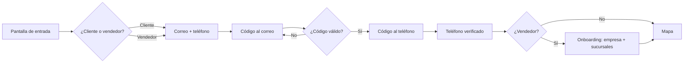
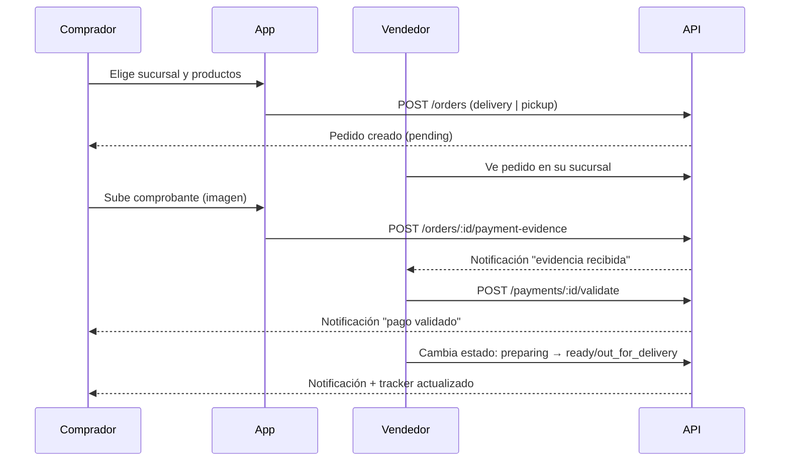

# 00 — Contexto, alcance y actores

## 1. Problema y oportunidad

Los comercios locales (tiendas de barrio, restaurantes, droguerías, ferreterías,
papelerías, etc.) venden principalmente por WhatsApp y redes: catálogos
dispersos, sin horarios confiables, sin estado del pedido y sin visibilidad de
qué hay cerca. El comprador, por su lado, no tiene una forma única de responder
"¿qué tiendas abiertas hay a 10 minutos de mi casa y qué venden?".

BuyersClub propone una **economía colaborativa geolocalizada**:

- Un **mapa único** de comercios con catálogo, horario y estado en vivo.
- **Pedidos** con entrega a domicilio o recogida en tienda, con seguimiento.
- **Chat** directo y **validación de pago** dentro de la app.
- **Datos** para el vendedor (ventas por sucursal) y para el comprador (sus
  compras).

## 2. Visión de producto

> Ser el mapa de referencia del comercio local: si un producto se vende cerca,
> aparece en BuyersClub.

Fase 1 = marketplace funcional, sin monetización ni restricciones de uso. El
objetivo es **densidad de oferta** (comercios registrados) y **repetibilidad de
compra** (pedidos por semana), no ingresos.

## 3. Actores y roles

| Actor | Descripción | Puede |
|---|---|---|
| **Comprador** (`buyer`) | Usuario final que descubre y pide | Ver mapa/catálogo, pedir, chatear, subir evidencia de pago, ver sus pedidos e indicadores |
| **Vendedor dueño** (`vendor_owner`) | Crea la empresa y sus sucursales | Todo lo del vendedor + gestionar sucursales, catálogo, horarios, estado activo, validar pagos |
| **Vendedor operador** (`vendor_staff`) | Empleado de una sucursal | Ver y gestionar pedidos de su sucursal, chatear, validar pagos. *(Fase 2; el MVP puede operar solo con dueño)* |
| **Administrador** (`admin`) | Equipo BuyersClub | Moderar comercios, ver métricas globales, soporte. *(Mínimo en MVP: backoffice interno)* |

Un mismo usuario **puede ser comprador y vendedor** a la vez. El rol no es
excluyente: al entrar se elige el "modo" (comprador/vendedor) pero la cuenta es
una sola.

## 4. Flujos principales

### 4.1 Registro y verificación

### 4.2 Pedido con evidencia de pago

### 4.3 Descubrimiento en mapa

1. El comprador abre el mapa centrado en su ubicación (o en una zona buscada).
2. La app pide `GET /discovery/branches?lat&lng&radius&...` (PostGIS).
3. Cada pin muestra nombre, categoría y estado (abierto/cerrado). Al tocar, ficha
   con catálogo, horario y botón "Pedir" (deshabilitado si está cerrado).
4. Filtros: categoría, abierto ahora, entrega/recogida, radio.

## 5. Alcance del MVP (fase 1)

### Dentro

- Registro/login con **contraseña** y verificación por **códigos OTP** (correo y teléfono).
- Verificación de correo real; verificación de teléfono **simulada/registrada**
  (sin SMS) con la estructura lista para conectar Twilio/MessageBird después.
- Onboarding de vendedor: empresa, N sucursales, dirección con geocodificación,
  horarios, estado activo manual, medios de entrega.
- Catálogo: productos a nivel empresa y **disponibilidad/precio por sucursal**
  (soporta catálogo compartido y catálogo propio por sucursal).
- Multi-moneda acotada: **COP** por defecto y **USD** opcional al crear la
  empresa, sin conversión entre monedas.
- Mapa de descubrimiento con radio, filtros y estado abierto/cerrado.
- Carrito y pedido: domicilio o recogida, notas, propina (opcional), costo de
  envío definido por sucursal.
- Tracker de estados + ETA estimada (cálculo simple, sin motor de ruteo).
- Chat por pedido con envío de imágenes.
- Evidencia de pago con imagen y **validación manual** por el vendedor.
- Lista de pedidos por sucursal (vendedor) y pedidos del comprador, con estados.
- Dashboard vendedor: ventas consolidadas y por sucursal, indicadores y filtros
  de fecha.
- Dashboard comprador: gasto, número de pedidos, indicadores y filtros.
- Push notifications en iOS/Android para eventos clave.
- Web responsive (misma base de código) para descubrimiento y pedido.

### Fuera (explícito)

- Pasarela de pagos / cobro dentro de la app (fase 3). El dinero se mueve por
  fuera; la app solo **registra evidencia y validación**.
- SMS real y verificación por WhatsApp (fase 2, depende de costo/proveedor).
- Motor de ruteo/ETA real, repartidores propios, tracking GPS del repartidor.
- Comisiones, planes, límites, publicidad, suscripciones.
- Reseñas y reputación, favoritos, cupones (fase 2–3).
- Multi-idioma y conversión entre monedas (COP/USD existen por empresa, sin FX).
- Inventario avanzado (variantes, lotes, modificadores de producto).
- Backoffice de administración completo (solo operaciones manuales en SQL).

## 6. Supuestos de trabajo

1. **País inicial: Colombia.** Moneda base **COP**; el vendedor puede elegir
   **USD** al crear su empresa. No hay conversión entre monedas en fase 1: cada
   empresa opera y reporta en su moneda.
2. Los montos se guardan en **enteros (centavos)**; nunca floats.
3. Un pedido pertenece a **una sola sucursal** (no multi-vendedor en un carrito).
4. El vendedor define el costo de envío; no hay tarifas por distancia en el MVP.
5. La ETA es una **estimación declarada** (preparación + tránsito fijo), no una
   promesa calculada con tráfico real.
6. El comprador debe tener al menos un pedido para poder chatear (el chat nace
   del pedido), lo que simplifica moderación y contexto.
7. El estado "abierto/cerrado" combina horario configurado **y** interruptor
   manual del vendedor; el manual manda.
8. Sin autenticación con Google/Apple en fase 1 (se deja el modelo preparado
   para `auth_providers`).

## 7. Reglas de negocio clave

| # | Regla |
|---|---|
| R1 | No se puede crear un pedido si la sucursal está cerrada (`manual_open = false` o fuera de horario) o no ofrece el medio elegido. |
| R2 | El pedido exige un método de pago; si es transferencia, queda en `awaiting_payment` hasta que el vendedor valide la evidencia. |
| R3 | Solo el vendedor dueño/operador de la sucursal puede validar pagos y cambiar estados del pedido. |
| R4 | El comprador solo puede cancelar mientras el pedido esté en `pending` o `awaiting_payment`. |
| R5 | Un pedido con evidencia rechazada vuelve a `awaiting_payment` y notifica al comprador. |
| R6 | El historial de estados es **append-only** (auditoría); nunca se sobrescribe. |
| R7 | Productos con precio nulo en la sucursal heredan el precio base de la empresa. |
| R8 | Un producto inactivo o sin stock en la sucursal no se puede añadir al carrito. |
| R9 | El vendedor no puede desactivar una sucursal con pedidos activos sin advertirlo. |
| R10 | Toda acción sensible (validar pago, cambio de estado, edición de precios) queda en el log de auditoría. |
| R11 | La moneda de la empresa (COP o USD) se define al crearla; no se puede cambiar si ya hay pedidos. Todos sus productos, pedidos y reportes usan esa moneda. |
| R12 | Un pedido no puede mezclar montos de distintas monedas; el servidor rechaza cualquier desajuste. |

## 8. Glosario

- **Empresa / Business**: la marca del vendedor (ej. "Panadería La 70").
- **Sucursal / Branch**: punto de venta físico con dirección, horario, estado y
  catálogo propio.
- **Catálogo compartido**: productos definidos a nivel empresa, disponibles en
  todas las sucursales por defecto.
- **Override por sucursal**: precio/stock/disponibilidad específicos de una
  sucursal sobre un producto de la empresa.
- **Evidencia de pago**: imagen (captura, foto del comprobante) que el comprador
  sube para que el vendedor valide el pago.
- **ETA**: hora estimada de entrega/recogida mostrada al comprador.
- **Tracker**: línea de tiempo del estado del pedido.
