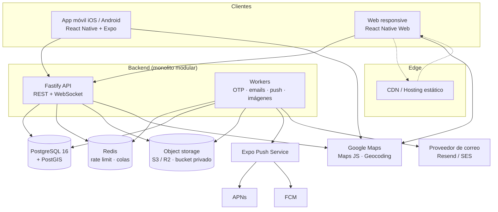

# 02 — Arquitectura

## 1. Vista general



**Principio rector**: monolito modular. Un proceso de API y un proceso de
workers, una base de datos, un bucket. Todo lo que se pueda posponer (microservicios,
event bus, caché distribuida, réplicas) se pospone.

## 2. Monorepo

```
buyersclub/
├── apps/
│   ├── mobile/                # Expo (iOS + Android + web)
│   │   ├── app/               # expo-router: rutas = archivos
│   │   │   ├── (auth)/        # welcome, phone, email-code, phone-code
│   │   │   ├── (buyer)/       # map, store/[id], cart, orders, chat, profile
│   │   │   └── (vendor)/      # dashboard, branches, catalog, orders, chat
│   │   ├── src/
│   │   │   ├── components/    # UI de producto
│   │   │   ├── features/      # hooks + estado por dominio
│   │   │   ├── lib/           # api client, storage, push, location
│   │   │   └── theme/
│   │   ├── app.config.ts
│   │   └── eas.json
│   └── api/
│       ├── src/
│       │   ├── modules/
│       │   │   ├── auth/      # otp, sesiones, tokens
│       │   │   ├── users/
│       │   │   ├── businesses/
│       │   │   ├── branches/  # horarios, estado, geocodificación
│       │   │   ├── catalog/   # productos, overrides por sucursal
│       │   │   ├── orders/    # carrito→pedido, estados, ETA
│       │   │   ├── payments/  # evidencia, validación
│       │   │   ├── chat/      # conversaciones, mensajes, WS
│       │   │   ├── discovery/ # consultas PostGIS
│       │   │   ├── analytics/ # dashboards
│       │   │   └── notifications/
│       │   ├── plugins/       # auth, db, storage, realtime, errors
│       │   ├── jobs/          # definiciones BullMQ
│       │   ├── db/            # schema Drizzle + migraciones + seeds
│       │   └── server.ts
│       └── drizzle.config.ts
├── packages/
│   ├── core/                  # tipos, Zod, reglas de negocio puras, dinero
│   ├── ui/                    # design system (RN + web)
│   └── config/                # tsconfig, eslint, prettier compartidos
├── infra/
│   ├── docker-compose.yml     # postgres+postgis, redis, minio, mailpit
│   └── scripts/
└── docs/
```

Reglas del monorepo:

- `apps/mobile` **nunca** importa código de `apps/api`; ambos importan
  `packages/core`.
- `packages/core` no depende de React ni de Fastify: es TypeScript puro
  (funciones de dinero, estados, validaciones, cálculo de ETA).
- Un solo lockfile (pnpm). Versiones de RN/Expo alineadas por el `expo` CLI.

## 3. Capas del backend

```
Ruta HTTP/WS → validación (Zod) → autorización (rol + tenant)
            → servicio de dominio → repositorio (Drizzle) → PostgreSQL
            → efectos: job (push/email), evento WS, auditoría
```

- **Rutas**: delgadas; solo parsean, validan y delegan.
- **Servicios**: reglas de negocio (R1–R10 de `00`). Es donde se testea.
- **Repositorios**: consultas Drizzle/SQL; sin lógica de negocio.
- **Autorización**: middleware `requireAuth` + `requireRole` +
  `assertBranchAccess(user, branchId)` para multi-tenancy.
- **Errores**: clase `AppError` con `code` estable; el handler los serializa.

## 4. Tiempo real

- Un solo endpoint WebSocket en la API: `GET /realtime?token=...`.
- Salas por `user:{id}`, `order:{id}`, `conversation:{id}`.
- Eventos: `message.created`, `order.status_changed`, `payment.updated`,
  `conversation.updated`.
- Persistencia en PostgreSQL y entrega *best effort*: al reconectar, el cliente
  hace `GET /sync?since=<cursor>` para recuperar lo perdido (no se depende del WS
  para la verdad).
- Push notification como respaldo cuando el usuario no está conectado.

## 5. Almacenamiento de archivos

1. La app pide `POST /files/presign` con tipo y tamaño.
2. La API valida (MIME permitido, ≤ 10 MB, cuota) y devuelve una URL prefirmada
   de subida.
3. La app sube la imagen directamente al bucket (comprime antes con
   `expo-image-manipulator`).
4. La app confirma con `POST /files/:id/complete`; la API verifica el objeto y
   genera una miniatura.
5. La descarga siempre es por URL prefirmada de corta duración.

Buckets: `public` (logos, fotos de producto) y `private` (evidencia de pago,
adjuntos de chat). Nunca se expone el bucket privado.

## 6. Seguridad

| Área | Medida |
|---|---|
| Autenticación | OTP de 6 dígitos, hash Argon2id, TTL 10 min, máximo 5 intentos, máx. 3 envíos / 15 min por destino |
| Sesiones | JWT access de 15 min + refresh token rotativo de 30 días (hash en BD, revocable por dispositivo) |
| Autorización | Rol + pertenencia a empresa/sucursal en cada operación (no confiar en el cliente) |
| Multi-tenancy | Todo query filtra por `business_id`; helper central para evitar olvidos |
| Archivos | Bucket privado, URLs firmadas de 5 min, validación de MIME real y tamaño, antivirus en fase 2 |
| Transporte | HTTPS obligatorio, HSTS, CORS restringido a los orígenes de la app/web |
| Rate limiting | Global por IP + por usuario en endpoints sensibles (OTP, login, pedidos, mensajes) |
| Datos | Nunca loggear tokens, códigos OTP ni URLs firmadas; PII minimizada |
| Auditoría | `audit_log` append-only para pagos, estados, precios y accesos de staff |
| Secretos | Variables de entorno por entorno; nunca en el repo ni en el cliente |

**Nota legal**: la plataforma **no procesa pagos**. Registra evidencia y una
validación del vendedor. Eso evita PCI-DSS, pero implica (a) términos que
declaren que el pago ocurre fuera de la app, (b) política de tratamiento de
imágenes y (c) responsabilidad clara frente a fraudes. Ver `07`.

## 7. Entornos

| Entorno | Uso | Infra |
|---|---|---|
| `local` | Desarrollo | Docker Compose: Postgres+PostGIS, Redis, MinIO, Mailpit |
| `staging` | QA, builds internas (EAS internal) | Servicios gestionados pequeños + datos sintéticos |
| `production` | Usuarios reales | Postgres gestionado con backups, API en 2 instancias, bucket R2/S3 |

## 8. CI/CD

- **CI en cada PR**: `pnpm typecheck`, `pnpm lint`, tests de `packages/core` y
  de servicios de la API, `expo-doctor`, chequeo de migraciones pendientes.
- **CD**: merge a `main` → deploy de API (Railway/Fly) + migraciones
  automáticas con *expand/contract* (compatibles hacia atrás). Web → build
  estático y deploy a Cloudflare Pages/Vercel.
- **Móvil**: tag `v*` → EAS Build (perfil `production`) → TestFlight / Play
  Internal → promoción manual a tiendas.
- **Rollback**: imágenes versionadas; migraciones siempre reversibles o
  compensadas por una nueva migración.

## 9. Observabilidad

- Logs estructurados (pino) con `request_id`, `user_id`, `route`, latencia.
- Errores a Sentry (API y app).
- `/health` (liveness) y `/health/ready` (DB, Redis, storage).
- Métricas mínimas: latencia p95 por ruta, errores 5xx, jobs fallidos, pedidos
  creados/validados, tamaño de colas.
- Alertas: 5xx > 1 %, cola de push atascada, disco/DB > 80 %.

## 10. Rendimiento

- Paginación por cursor en listas; límite duro en búsquedas de mapa (p. ej. 200
  sucursales por viewport, cluster en el cliente).
- Índices: GiST en `branches.location`, B-tree en FKs y en
  `(branch_id, created_at)` de pedidos, `(conversation_id, created_at)` de
  mensajes.
- Imágenes: compresión en cliente + variantes servidas por CDN.
- Cache: TanStack Query en el cliente; Redis para rate limits y jobs (no para
  datos de negocio en fase 1).
- Analítica: SQL agregado con `date_trunc` y zona horaria de la sucursal;
  materializar vistas solo si las consultas superan ~300 ms.

## 11. ADRs

### ADR-001 — React Native + Expo como cliente único
- **Contexto**: se requiere Android, iOS y web con un equipo pequeño.
- **Decisión**: Expo + expo-router + React Native Web.
- **Consecuencias**: una base de código; la web es "app-like", no un sitio SEO.
  Revisar ADR-002 si el SEO se vuelve crítico.

### ADR-002 — Web separada (Next.js) solo si el SEO lo exige
- **Decisión**: no crear dos frontends ahora. La lógica vive en `packages/core`.
- **Consecuencias**: si se agrega `apps/web`, reutiliza API y reglas; el costo es
  mantener dos UIs.

### ADR-003 — Proveedor de mapas detrás de una interfaz
- **Decisión**: `packages/ui/map` con implementación `.native.tsx` y `.web.tsx`.
- **Consecuencias**: cambiar de Google a MapLibre/OSM es un cambio localizado.

### ADR-004 — Monolito modular con REST + WebSocket
- **Decisión**: un proceso API, un proceso worker, módulos por dominio.
- **Consecuencias**: simple de desplegar y depurar; se puede extraer un módulo a
  servicio si hace falta.

### ADR-005 — PostGIS para proximidad
- **Decisión**: `geography(Point,4326)` + `ST_DWithin`/`ST_Distance`, índice GiST.
- **Consecuencias**: búsquedas por radio exactas en metros; requiere extensión
  PostGIS en el proveedor (Neon y Supabase la soportan).

### ADR-006 — Autenticación passwordless con OTP
- **Decisión**: correo con OTP real; teléfono con OTP registrado pero **sin
  envío SMS** en fase 1 (se muestra el código en modo desarrollo y se marca el
  número como "no verificado por SMS").
- **Consecuencias**: menos fricción y sin costo de SMS; el modelo
  `verifications` ya soporta el canal `sms` para activarlo después. Riesgo de
  suplantación de teléfono asumido y documentado en `07`.

### ADR-007 — Dinero en enteros
- **Decisión**: `*_cents BIGINT` + `currency CHAR(3)`.
- **Consecuencias**: sin errores de coma flotante; el formateo vive en
  `packages/core`.

### ADR-008 — Evidencia de pago privada, sin procesar pagos
- **Decisión**: bucket privado + validación manual del vendedor + auditoría.
- **Consecuencias**: no hay PCI; sí hay riesgo de fraude (ver `07`).

### ADR-009 — Catálogo compartido con overrides por sucursal
- **Decisión**: `products` a nivel empresa + `branch_products` (precio, stock,
  disponibilidad) por sucursal.
- **Consecuencias**: soporta ambos modelos sin duplicar productos.

### ADR-010 — Estado abierto/cerrado calculado en el servidor
- **Decisión**: el servidor devuelve `is_open` y `next_change_at` combinando
  `manual_open` + horarios + excepciones (zona horaria de la sucursal).
- **Consecuencias**: web y app muestran lo mismo; el cliente no recalcula reglas.

### ADR-011 — Historial de estados append-only
- **Decisión**: `order_status_events` inmutable + `audit_log` para acciones
  sensibles.
- **Consecuencias**: trazabilidad y soporte; no se "corrige" un estado, se
  agrega un evento.

### ADR-012 — Multi-tenancy validada en la capa de servicio
- **Decisión**: sin RLS en fase 1; helpers `assertBusinessAccess` y
  `assertBranchAccess` obligatorios en servicios.
- **Consecuencias**: menos fricción de desarrollo; si se exponen datos
  directamente al cliente o crece el equipo, evaluar RLS como defensa en
  profundidad.

### ADR-013 — Analítica sobre SQL, no un servicio externo
- **Decisión**: endpoints de dashboard con consultas agregadas y filtros de
  fecha; vistas materializadas solo si es necesario.
- **Consecuencias**: cero costo extra; migrar a un almacén analítico si el
  volumen lo exige.

### ADR-014 — EAS para builds y OTA
- **Decisión**: EAS Build + EAS Update; sin Mac propio.
- **Consecuencias**: costo por build en planes altos; el plan gratuito alcanza
  para el MVP.
