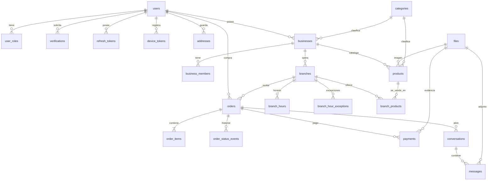
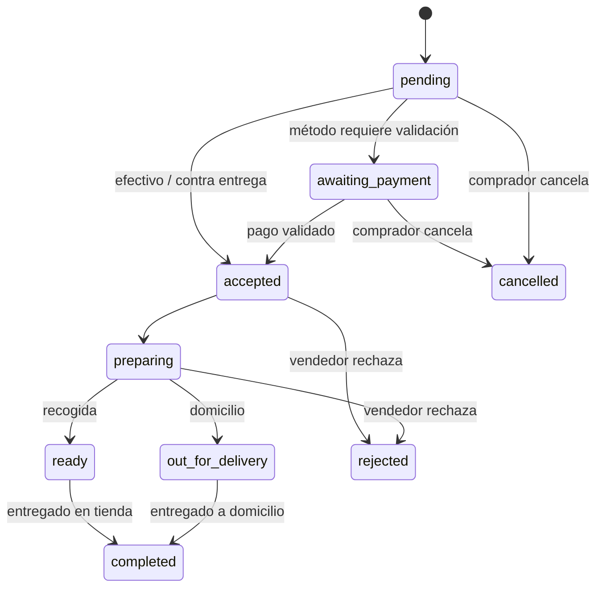

# 03 — Modelo de datos

Base: **PostgreSQL 16 + PostGIS 3**. Convenciones:

- IDs `uuid` (v7 si el runtime lo permite; si no, `gen_random_uuid()`).
- Fechas `timestamptz` en UTC; la zona horaria de la sucursal se usa para
  horarios y reportes.
- Dinero en `BIGINT` de centavos + `currency CHAR(3)`.
- `created_at`/`updated_at` en todas las tablas; borrado lógico solo donde se
  indica.
- Enums nativos de Postgres para estados (validación gratis y valores legibles).

## 1. Diagrama entidad-relación (núcleo)



## 2. Identidad y acceso

### `users`
| Columna | Tipo | Notas |
|---|---|---|
| `id` | uuid PK | |
| `email` | citext UNIQUE NOT NULL | normalizado a minúsculas |
| `email_verified_at` | timestamptz NULL | |
| `phone_e164` | text UNIQUE NOT NULL | formato E.164 (`+573001234567`) |
| `phone_verified_at` | timestamptz NULL | en fase 1 queda NULL si no hay SMS |
| `phone_verification_method` | text NULL | `sms` / `manual_dev` |
| `full_name` | text NULL | |
| `avatar_file_id` | uuid FK `files` | |
| `locale` | text default `es` | |
| `status` | enum `active`,`blocked` | |
| `created_at` / `updated_at` | timestamptz | |

> No hay `password_hash`: la autenticación es por OTP (ADR-006). Se deja la
> puerta abierta a `auth_identities` (Google/Apple) en fase 2.

### `verifications`
| Columna | Tipo | Notas |
|---|---|---|
| `id` | uuid PK | |
| `user_id` | uuid FK NULL | null en el primer registro (aún no existe usuario) |
| `channel` | enum `email`,`sms` | |
| `destination` | text | correo o teléfono |
| `purpose` | enum `signup`,`login`,`verify_email`,`verify_phone`,`reset` | |
| `code_hash` | text | Argon2id; nunca el código en claro |
| `expires_at` | timestamptz | 10 min |
| `consumed_at` | timestamptz NULL | un solo uso |
| `attempts` | int default 0 | máx. 5 |
| `ip` / `user_agent` | text | antifraude básico |
| `created_at` | timestamptz | |

Índice: `(destination, purpose, created_at DESC)`.

### `refresh_tokens`
`id`, `user_id`, `token_hash`, `device_name`, `platform`, `expires_at`,
`revoked_at`, `last_used_at`, `created_at`. Rotación en cada refresh.

### `device_tokens`
`id`, `user_id`, `expo_push_token` UNIQUE, `platform` (`ios`/`android`),
`app_version`, `last_seen_at`, `created_at`. Se invalida al cerrar sesión o al
recibir `DeviceNotRegistered`.

### `user_roles`
`user_id`, `role` (`buyer`,`vendor_owner`,`vendor_staff`,`admin`),
`business_id` NULL (solo para roles de vendedor), `created_at`.
PK `(user_id, role, business_id)`.

## 3. Negocio y sucursales

### `businesses`
`id`, `owner_user_id` FK, `name`, `slug` UNIQUE, `description`, `logo_file_id`,
`category_id` FK, `tax_id` (NIT/RUC, opcional), `currency` CHAR(3) NOT NULL
DEFAULT `'COP'` con `CHECK (currency IN ('COP','USD'))`,
`status` (`draft`,`active`,`suspended`), `created_at`, `updated_at`.

La moneda se elige al crear la empresa y **no se puede cambiar si ya existen
pedidos** (los pedidos guardan su propia moneda como snapshot). Todos los
productos, precios de sucursal, pedidos y reportes de esa empresa usan la misma
moneda. No hay conversión FX en fase 1.

### `business_members`
`business_id`, `user_id`, `role` (`owner`,`staff`), `branch_id` NULL
(si el staff solo opera una sucursal), `created_at`.

### `branches`
| Columna | Tipo | Notas |
|---|---|---|
| `id` | uuid PK | |
| `business_id` | uuid FK | |
| `name` | text | "Sede Chapinero" |
| `phone` | text | |
| `address_line` | text | |
| `city`, `region`, `country` | text | `country` ISO-2 |
| `lat`, `lng` | double precision | |
| `location` | geography(Point,4326) | actualizado por trigger desde lat/lng |
| `timezone` | text | ej. `America/Bogota` |
| `manual_open` | boolean default false | interruptor del vendedor (manda) |
| `pickup_enabled` | boolean default true | |
| `delivery_enabled` | boolean default true | |
| `delivery_fee_cents` | bigint default 0 | |
| `min_order_cents` | bigint default 0 | |
| `prep_time_minutes` | int default 20 | |
| `delivery_eta_minutes` | int default 20 | tránsito estimado |
| `status` | enum `active`,`paused`,`closed` | |
| `created_at`, `updated_at` | timestamptz | |

Índices: GiST(`location`), btree(`business_id`), btree(`city`).

### `branch_hours`
`id`, `branch_id`, `weekday` smallint 0–6 (0 = domingo), `opens_at` time,
`closes_at` time, `is_closed` boolean. Se permiten varias franjas por día
(mediodía cerrado).

### `branch_hour_exceptions`
`id`, `branch_id`, `date` date, `is_closed` boolean, `opens_at`/`closes_at`
NULL, `note`. Para festivos y horarios especiales.

### Función de estado
```sql
-- Devuelve el estado operativo combinando interruptor manual + horario + excepción
CREATE FUNCTION branch_is_open(p_branch_id uuid, p_at timestamptz DEFAULT now())
RETURNS boolean ...
```
El endpoint de descubrimiento devuelve `is_open` y `next_change_at` para que la
app muestre "abre a las 8:00" sin recalcular reglas.

## 4. Catálogo

### `categories`
`id`, `parent_id` NULL, `name`, `slug` UNIQUE, `icon`, `sort_order`.

### `products`
`id`, `business_id` FK, `category_id` FK, `name`, `description`,
`image_file_id`, `base_price_cents` bigint, `currency`, `sku` NULL,
`is_active` boolean, `attributes` jsonb (talla, color, presentación…),
`created_at`, `updated_at`.

Índices: `(business_id, is_active)`, GIN trigram en `name` para búsqueda.

### `branch_products` (catálogo compartido + overrides)
| Columna | Tipo | Notas |
|---|---|---|
| `branch_id` | uuid FK | PK compuesta |
| `product_id` | uuid FK | PK compuesta |
| `price_cents` | bigint NULL | NULL ⇒ hereda `products.base_price_cents` |
| `stock` | int NULL | NULL ⇒ sin control de stock |
| `is_available` | boolean default true | |

Esta tabla resuelve el requisito "usar los mismos productos en todas las
sucursales o registrar productos por sucursal":

- Producto compartido: fila en `products` + filas en `branch_products` para todas
  las sucursales (se crean por defecto al añadir el producto a la empresa).
- Producto exclusivo: `products` con `branch_products` solo para esa sucursal.
- Precio distinto por sede: `branch_products.price_cents` no nulo.

## 5. Pedidos

### Enums de estado

`order_status`:
`pending` → `awaiting_payment` → `accepted` → `preparing` →
`ready` (recogida) | `out_for_delivery` (domicilio) → `completed`;
laterales: `cancelled`, `rejected`.

`payment_method`: `cash`, `transfer`, `card_terminal`, `other`.
`payment_status`: `pending`, `evidence_submitted`, `validated`, `rejected`,
`refunded`.



### `orders`
| Columna | Tipo | Notas |
|---|---|---|
| `id` | uuid PK | |
| `code` | text UNIQUE | código corto legible (ej. `BC-7F3K2`) |
| `buyer_user_id` | uuid FK | |
| `business_id` | uuid FK | denormalizado para reportes |
| `branch_id` | uuid FK | |
| `fulfillment` | enum `delivery`,`pickup` | |
| `status` | `order_status` | |
| `payment_method` | `payment_method` | |
| `payment_status` | `payment_status` | |
| `subtotal_cents`, `delivery_fee_cents`, `discount_cents`, `total_cents` | bigint | |
| `currency` | char(3) | |
| `buyer_name`, `buyer_phone` | text | snapshot al momento del pedido |
| `delivery_address_id` | uuid FK NULL | |
| `delivery_address_snapshot` | jsonb NULL | dirección congelada |
| `notes` | text | |
| `scheduled_for` | timestamptz NULL | pedido programado (fase 2) |
| `eta_at` | timestamptz NULL | |
| `accepted_at`, `ready_at`, `picked_up_at`, `delivered_at`, `cancelled_at` | timestamptz | |
| `cancel_reason` | text | |
| `created_at`, `updated_at` | timestamptz | |

Índices: `(branch_id, status, created_at DESC)`,
`(buyer_user_id, created_at DESC)`, `(business_id, created_at)`.

`currency` se copia de la empresa al crear el pedido (snapshot) y **no se
recalcula**: si la empresa cambia de moneda en el futuro, el historial conserva
la moneda original.

### `order_items`
`id`, `order_id`, `product_id` (FK con `ON DELETE RESTRICT`),
`name_snapshot`, `unit_price_cents`, `qty` int, `line_total_cents`, `notes`,
`options` jsonb. **Snapshot de nombre y precio** para que el historial no cambie
si el producto se edita.

### `order_status_events` (append-only)
`id`, `order_id`, `from_status`, `to_status`, `actor_user_id`, `note`,
`created_at`. Sin UPDATE ni DELETE (permiso revocado al rol de la app).

## 6. Pagos y evidencia

### `payments`
| Columna | Tipo | Notas |
|---|---|---|
| `id` | uuid PK | |
| `order_id` | uuid FK | |
| `method` | `payment_method` | |
| `amount_cents` | bigint | |
| `currency` | char(3) | |
| `status` | `payment_status` | |
| `evidence_file_id` | uuid FK `files` NULL | imagen en bucket privado |
| `evidence_note` | text | referencia/últimos dígitos |
| `submitted_at` | timestamptz | |
| `validated_by_user_id` | uuid FK | |
| `validated_at` | timestamptz | |
| `rejection_reason` | text | |
| `created_at`, `updated_at` | timestamptz | |

Regla: un pedido puede tener varios registros de pago (rechazo → reenvío) pero
solo uno `validated`.

## 7. Chat

### `conversations`
`id`, `order_id` FK UNIQUE, `buyer_user_id`, `business_id`, `branch_id`,
`last_message_at`, `buyer_last_read_at`, `vendor_last_read_at`, `created_at`.
Se crea automáticamente con el pedido.

### `messages`
`id`, `conversation_id`, `sender_user_id`, `body` text NULL,
`file_id` uuid FK NULL, `created_at`, `deleted_at` NULL.
Índice `(conversation_id, created_at)`. Validación: `body` o `file_id` (al menos
uno).

## 8. Archivos, notificaciones y auditoría

### `files`
`id`, `owner_user_id`, `bucket` (`public`/`private`), `key`, `mime`,
`size_bytes`, `width`, `height`, `sha256`, `status` (`pending`,`ready`),
`created_at`.

### `notifications`
`id`, `user_id`, `type` (`order_status`,`payment`,`chat`,`system`), `title`,
`body`, `data` jsonb, `read_at`, `created_at`. Sirve de bandeja in-app además
del push.

### `audit_log`
`id`, `actor_user_id`, `business_id`, `action` text, `entity_type`,
`entity_id`, `metadata` jsonb, `ip`, `created_at`. Append-only.

## 9. Consultas clave

### Tiendas cercanas
```sql
SELECT b.id, b.name, b.lat, b.lng,
       ST_Distance(b.location, p.location) AS distance_m,
       branch_is_open(b.id) AS is_open
FROM branches b
JOIN branches p ON p.id = $origin_branch_or_point
WHERE b.status = 'active'
  AND ST_DWithin(b.location, p.location, $radius_m)
ORDER BY distance_m
LIMIT 200;
```
En la práctica se recibe un punto (`ST_SetSRID(ST_MakePoint(lng, lat),4326)::geography`)
y se filtra por categoría, `pickup_enabled`/`delivery_enabled` y `is_open`.

### Ventas por sucursal (dashboard vendedor)
```sql
SELECT branch_id,
       count(*) FILTER (WHERE status = 'completed')            AS orders_completed,
       sum(total_cents) FILTER (WHERE status = 'completed')    AS revenue_cents,
       avg(total_cents) FILTER (WHERE status = 'completed')    AS avg_ticket_cents
FROM orders
WHERE business_id = $1
  AND created_at >= $from AND created_at < $to
GROUP BY branch_id;
```
Series temporales con `date_trunc('day', created_at AT TIME ZONE b.timezone)`.

### Indicadores comprador
Órdenes por estado, gasto total y por mes, ticket promedio, comercios
frecuentes, pedidos activos. Si el comprador compró en negocios con COP y USD,
los totales se devuelven separados por moneda (sin conversión).

## 10. Migraciones y datos

- `drizzle-kit generate` produce SQL versionado; `drizzle-kit migrate` lo aplica.
- Estrategia **expand/contract** para despliegues sin downtime.
- Seeds de desarrollo: 1 admin, 2 vendedores con 3 sucursales, ~30 productos,
  10 pedidos en distintos estados y conversaciones con imágenes de ejemplo.
- Script `npm run db:reset` para levantar el entorno local desde cero.

## 11. Retención y privacidad

| Dato | Retención propuesta |
|---|---|
| Evidencia de pago | 12 meses (luego se elimina la imagen; se conserva el registro) |
| Mensajes de chat | 24 meses |
| Auditoría | 24 meses |
| Cuenta inactiva | Anonimización a los 24 meses, borrado a solicitud |

Política de borrado de cuenta: se anonimizan datos personales y se conservan
pedidos agregados por obligaciones contables. Incluir endpoint de eliminación
desde la app (requisito de App Store).
