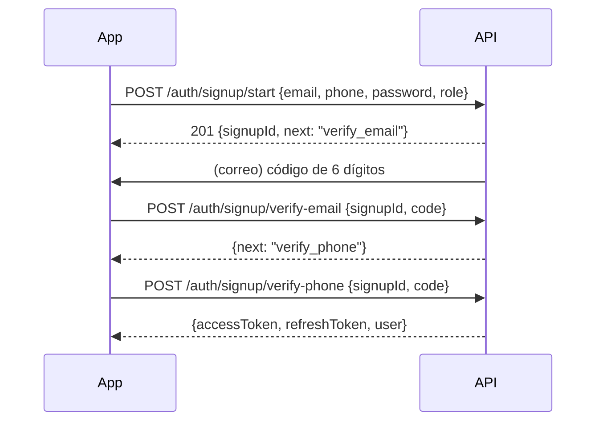

# 04 — API y contratos

## 1. Convenciones

- Base: `https://api.buyersclub.app/v1` (staging: `api.staging...`).
- JSON en `camelCase`; fechas ISO-8601 UTC (`2026-01-31T14:05:00Z`).
- Dinero: `{ "amountCents": 1250000, "currency": "COP" }` en respuestas
  financieras; los endpoints de escritura aceptan `amountCents`.
- IDs: UUID en string.
- Autenticación: `Authorization: Bearer <accessToken>`.
- Paginación por cursor: `?limit=20&cursor=<opaque>` →
  `{ "items": [...], "nextCursor": "..." }`.
- Escrituras críticas (`POST /orders`, `POST /payments/:id/validate`) aceptan
  `Idempotency-Key` (UUID del cliente) y son idempotentes durante 24 h.
- Errores uniformes:

```json
{
  "error": {
    "code": "BRANCH_CLOSED",
    "message": "La sucursal está cerrada en este momento.",
    "details": { "nextChangeAt": "2026-01-31T13:00:00Z" }
  }
}
```

Códigos HTTP: 400 validación, 401 sin sesión, 403 sin permiso, 404 no existe,
409 conflicto de estado, 422 regla de negocio, 429 rate limit, 500 inesperado.

Códigos de error estables: `VALIDATION_ERROR`, `UNAUTHORIZED`, `FORBIDDEN`,
`NOT_FOUND`, `PHONE_TAKEN`, `EMAIL_TAKEN`, `OTP_INVALID`, `OTP_EXPIRED`,
`OTP_TOO_MANY_ATTEMPTS`, `BRANCH_CLOSED`, `FULFILLMENT_UNAVAILABLE`,
`PRODUCT_UNAVAILABLE`, `MIN_ORDER_NOT_MET`, `ORDER_STATE_INVALID`,
`PAYMENT_ALREADY_VALIDATED`, `PAYMENT_EVIDENCE_REQUIRED`, `RATE_LIMITED`.

OpenAPI 3.1 generado desde los esquemas Zod (fuente única en
`packages/core/contracts`); la app puede generar tipos cliente.

## 2. Autenticación

Flujo de registro (correo y teléfono obligatorios):



En fase 1 el código del teléfono se registra pero **no se envía por SMS**: se
genera, se guarda hasheado y en `staging/local` se devuelve en la respuesta bajo
un flag `devCode` (nunca en producción). La UI explica que la verificación por
SMS llegará pronto.

La contraseña se guarda con **scrypt** (salt por usuario y parámetros
versionados). Recuperarla exige un código al correo y revoca todas las sesiones
activas.

| Método | Ruta | Descripción |
|---|---|---|
| POST | `/auth/signup/start` | Crea usuario pendiente y envía OTP al correo. `{email, phone, password, fullName?, role}` |
| POST | `/auth/signup/verify-email` | Valida OTP de correo. `{signupId, code}` |
| POST | `/auth/signup/verify-phone` | Valida OTP de teléfono y emite tokens |
| POST | `/auth/otp/resend` | Reenvía OTP. `{channel, destination, purpose}` (rate limited) |
| POST | `/auth/login` | Inicia sesión con contraseña. `{identifier, password}` |
| POST | `/auth/login/otp` | Envía un código de acceso alternativo. `{identifier}` |
| POST | `/auth/login/otp/verify` | `{identifier, code}` → tokens |
| POST | `/auth/password/reset/request` | `{email}`; respuesta genérica (no revela si existe) |
| POST | `/auth/password/reset` | `{email, code, password}`; revoca sesiones |
| POST | `/auth/refresh` | `{refreshToken}` rotativo |
| POST | `/auth/logout` | Revoca refresh token del dispositivo |
| GET | `/me` | Perfil + roles + onboarding |
| PATCH | `/me` | Nombre, avatar, locale |
| DELETE | `/me` | Elimina/anonimiza la cuenta (requisito de tiendas) |
| POST | `/me/devices` | Registra `expoPushToken`, plataforma |
| DELETE | `/me/devices/:token` | Desregistra push |

`GET /me`:
```json
{
  "id": "…",
  "email": "ana@example.com",
  "phone": "+573001234567",
  "emailVerifiedAt": "2026-01-31T13:00:00Z",
  "phoneVerifiedAt": "2026-01-31T13:05:00Z",
  "phoneVerificationMethod": "otp_dev",
  "roles": ["buyer", "vendor_owner"],
  "onboarding": { "buyerComplete": true, "vendorComplete": false }
}
```

## 3. Descubrimiento (mapa)

| Método | Ruta | Descripción |
|---|---|---|
| GET | `/categories` | Categorías globales (público) |
| GET | `/discovery/branches` | Sucursales en un radio. Params: `lat`, `lng` (obligatorios), `radius` (m, máx. 20000), `categoryId`, `openNow`, `fulfillment` (`delivery`/`pickup`), `q`, `limit` (máx. 200) |
| GET | `/discovery/branches/:id` | Ficha pública: sucursal, horario, estado, catálogo disponible |
| GET | `/discovery/search` | Búsqueda por texto de tiendas y productos |

> El endpoint es **público** y calcula `isOpen` en el servidor combinando el
> interruptor manual, el horario por día, las excepciones y la zona horaria de la
> sucursal. `openNow=true` se filtra después del cálculo; `distanceMeters` sale de
> PostGIS (`ST_DWithin` + índice GiST). El mapa visual usa Google Maps cuando
> `GOOGLE_MAPS_API_KEY` está configurada.

Respuesta de `/discovery/branches`:
```json
{
  "items": [
    {
      "id": "…",
      "name": "Sede Chapinero",
      "business": { "id": "…", "name": "Panadería La 70", "logoUrl": "…" },
      "category": { "id": "…", "name": "Panadería" },
      "location": { "lat": 4.6486, "lng": -74.0628 },
      "distanceMeters": 420,
      "isOpen": true,
      "nextChangeAt": "2026-01-31T22:00:00Z",
      "fulfillment": { "delivery": true, "pickup": true },
      "deliveryFee": { "amountCents": 300000, "currency": "COP" },
      "minOrder": { "amountCents": 1000000, "currency": "COP" },
      "rating": null,
      "productPreview": [{ "name": "Pan campesino", "priceCents": 450000 }]
    }
  ],
  "nextCursor": null
}
```

Reglas: `isOpen` lo calcula el servidor (ADR-010); nunca el cliente. El límite
de 200 y el viewport evitan cargas masivas.

## 4. Negocio y sucursales (vendedor)

| Método | Ruta | Descripción |
|---|---|---|
| POST | `/businesses` | Onboarding: crea empresa. `{name, description?, categoryId?, currency?}`; `currency` ∈ `COP`/`USD`, por defecto `COP` |
| GET | `/businesses/me` | Empresa(s) del usuario con sucursales y conteo de productos |
| PATCH | `/businesses/:id` | Nombre, categoría, descripción y moneda (solo sin pedidos) |
| POST | `/businesses/:id/branches` | Crea sucursal. `{name, addressLine, city, phone?, lat?, lng?, timezone?, deliveryFeeCents?, minOrderCents?, prepTimeMinutes?, deliveryEtaMinutes?, pickupEnabled?, deliveryEnabled?}`. Si no hay lat/lng se geocodifica (Google si hay key, Nominatim en desarrollo) |
| GET | `/businesses/:id/branches` | Sucursales con horarios y excepciones |
| PATCH | `/branches/:id` | Dirección, contacto, envío, mínimos, ETA, medios y estado |
| PUT | `/branches/:id/hours` | Reemplaza horarios. `{ranges: [{weekday, opensAt, closesAt}], exceptions: [...]}` |
| POST | `/branches/:id/open` | Interruptor manual. `{manualOpen: true}` |
| GET | `/branches/:id/products` | Catálogo efectivo de la sucursal (precio con override) |
| GET | `/branches/:id/orders` | *(Fase 4)* Pedidos de la sucursal. `?status=&from=&to=&cursor=` |

Validaciones: `timezone` IANA; `lat/lng` dentro del rango válido; `deliveryFeeCents ≥ 0`;
dirección y ciudad obligatorias.

## 5. Catálogo

| Método | Ruta | Descripción |
|---|---|---|
| GET | `/products` | Productos de la empresa. `?businessId=` (obligatorio) |
| POST | `/products` | Crea producto. `{businessId, name, description?, categoryId?, basePriceCents, imageFileId?, branchIds?, shareWithAllBranches?}` |
| PATCH | `/products/:id` | Edita producto, precio, disponibilidad |
| DELETE | `/products/:id` | Desactiva (soft delete) |
| PUT | `/products/:id/branches` | Define en qué sucursales está y con qué overrides `{branches: [{branchId, priceCents?, stock?, isAvailable}]}` |

`shareWithAllBranches: true` genera filas en `branch_products` para cada
sucursal activa; las sucursales nuevas heredan los productos marcados como
compartidos.

## 6. Pedidos

| Método | Ruta | Actor | Descripción |
|---|---|---|---|
| POST | `/orders` | comprador | Crea pedido; recalcula precios y valida sucursal abierta, mínimo y stock |
| GET | `/orders` | comprador | Sus pedidos con estado, total e ítems |
| GET | `/orders/:id` | ambos | Detalle + ítems + historial + ETA |
| POST | `/orders/:id/cancel` | comprador | Solo en `pending`/`awaiting_payment` |
| POST | `/orders/:id/status` | vendedor | Transición validada |
| GET | `/businesses/:id/orders` | vendedor | Pedidos de la empresa, `?status=` |
| POST | `/orders/:id/payment-evidence` | comprador | `{fileId, note?}` |
| POST | `/payments/:id/validate` | vendedor | Marca pago validado; el pedido pasa a `accepted` |
| POST | `/payments/:id/reject` | vendedor | `{reason}` |

`POST /orders`:
```json
{
  "branchId": "…",
  "fulfillment": "delivery",
  "paymentMethod": "cash",
  "items": [{ "productId": "…", "qty": 2, "notes": "sin azúcar" }],
  "deliveryAddress": {
    "line1": "Calle 70 # 10-20",
    "city": "Bogotá",
    "recipientName": "Ana",
    "phone": "+573001234567",
    "notes": "Timbre 2B"
  },
  "notes": "Entregar antes de las 6",
  "clientTotalCents": 1300000
}
```

El servidor **recalcula** precios y totales (nunca confía en el cliente); si
`clientTotalCents` no coincide, responde `409 PRICE_CHANGED` con el desglose. Los
precios aplicados son los de `branch_products` (o el base). La moneda sale de la
empresa. El pedido se rechaza si la sucursal está cerrada (`409 BRANCH_CLOSED`),
no ofrece el medio elegido (`422`), no alcanza el mínimo (`422 MIN_ORDER_NOT_MET`)
o un producto no está disponible (`422 PRODUCT_UNAVAILABLE`).

Con `paymentMethod = transfer` el pedido nace en `awaiting_payment`; el vendedor
no puede aceptarlo hasta validar la evidencia.

Transiciones permitidas (`POST /orders/:id/status`):

| Desde | Hacia | Quién |
|---|---|---|
| `pending` | `accepted`, `rejected`, `cancelled` | vendedor (accepted/rejected) / comprador (cancelled) |
| `awaiting_payment` | `accepted` (solo si pago validado), `cancelled` | vendedor / comprador |
| `accepted` | `preparing`, `rejected` | vendedor |
| `preparing` | `ready`, `out_for_delivery`, `rejected` | vendedor |
| `ready` | `completed` | vendedor |
| `out_for_delivery` | `completed` | vendedor |

Cualquier otra transición devuelve `422 ORDER_STATE_INVALID`.

## 7. Chat

| Método | Ruta | Descripción |
|---|---|---|
| GET | `/conversations` | Bandeja del usuario (comprador o vendedor) |
| GET | `/conversations/:id/messages` | `?before=&limit=30` |
| POST | `/conversations/:id/messages` | `{body?, fileId?}` |
| POST | `/conversations/:id/read` | Marca leído |
| WS | `/realtime?token=…` | *(F7)* Eventos en vivo; el MVP usa polling cada 4 s |

Eventos del WebSocket:

```json
{ "type": "message.created", "conversationId": "…", "message": { "id": "…", "body": "…", "fileUrl": null, "senderId": "…", "createdAt": "…" } }
{ "type": "order.status_changed", "orderId": "…", "from": "preparing", "to": "ready", "etaAt": "…" }
{ "type": "payment.updated", "orderId": "…", "paymentId": "…", "status": "validated" }
{ "type": "conversation.updated", "conversationId": "…", "lastMessageAt": "…" }
```

Reconexión con backoff y `GET /sync?since=<ISO>` para recuperar eventos
perdidos (el WS no es la fuente de verdad).

## 8. Notificaciones

| Método | Ruta | Descripción |
|---|---|---|
| GET | `/notifications` | Bandeja in-app, `?unread=true&cursor=` |
| POST | `/notifications/read` | `{ids?: [...]}` o todas |

Push (servidor → Expo): se envía un job por evento con `title`, `body`,
`data: { deeplink }`. Tipos: `order.status_changed`, `payment.evidence_received`,
`payment.validated`, `payment.rejected`, `chat.message`, `order.new` (vendedor).

## 9. Analítica

| Método | Ruta | Descripción |
|---|---|---|
| GET | `/analytics/vendor` | `?businessId=&from=YYYY-MM-DD&to=YYYY-MM-DD&granularity=day\|week\|month`. Resumen, comparación con el periodo anterior, por sucursal, serie, top productos y embudo |
| GET | `/analytics/buyer` | `?from&to&granularity`. Totales por moneda, pedidos activos, serie y comercios frecuentes |

Solo cuentan como ventas/gasto los pedidos `completed`. Las fechas se
interpretan en la zona horaria de la primera sucursal (vendedor) o
`America/Bogota` (comprador); `from` y `to` son inclusivos.

Respuesta de `/analytics/vendor`:
```json
{
  "range": { "from": "2026-01-01", "to": "2026-01-31", "granularity": "day" },
  "summary": {
    "revenueCents": 128400000,
    "ordersCompleted": 87,
    "ordersCreated": 95,
    "ordersCancelled": 4,
    "avgTicketCents": 1475800
  },
  "comparison": {
    "revenuePct": 12.4,
    "ordersPct": 8.1,
    "previous": { "revenueCents": 114200000, "ordersCompleted": 80 }
  },
  "byBranch": [
    { "branchId": "…", "branchName": "Sede Chapinero", "revenueCents": 70200000, "ordersCompleted": 48 }
  ],
  "timeseries": [{ "bucket": "2026-01-01", "revenueCents": 4200000, "orders": 3 }],
  "topProducts": [
    { "productId": "…", "name": "Pan campesino", "qty": 120, "revenueCents": 54000000 }
  ],
  "funnel": [{ "status": "completed", "count": 87 }]
}
```

`revenuePct` y `ordersPct` son `null` cuando no hay periodo anterior comparable.
`/analytics/buyer` devuelve `totalsByCurrency`, `ordersCreated`, `activeOrders`,
`timeseries` por moneda y `frequent`; no convierte entre monedas.

## 10. Archivos

| Método | Ruta | Descripción |
|---|---|---|
| POST | `/files` | `multipart/form-data` con `file`; imágenes JPG/PNG/WebP ≤ 10 MB; devuelve `{file: {id, mime, sizeBytes, url}}` |
| GET | `/files/:id` | Imagen privada; requiere Bearer o `?token=` firmado (15 min) |

Límites: imagen ≤ 10 MB, MIME `image/jpeg|png|webp`; evidencia y chat siempre
en bucket privado.

## 11. Rate limits

| Endpoint | Límite |
|---|---|
| `/auth/otp/resend` | 3 / 15 min por destino, 10 / hora por IP |
| `/auth/*verify` | 5 intentos / código, 20 / hora por IP |
| `POST /orders` | 10 / hora por usuario |
| `POST /conversations/:id/messages` | 60 / hora por usuario |
| `GET /discovery/*` | 120 / min por IP |
| Global | 300 req / min por usuario autenticado |

Respuesta `429` con `Retry-After` y `RATE_LIMITED`.
